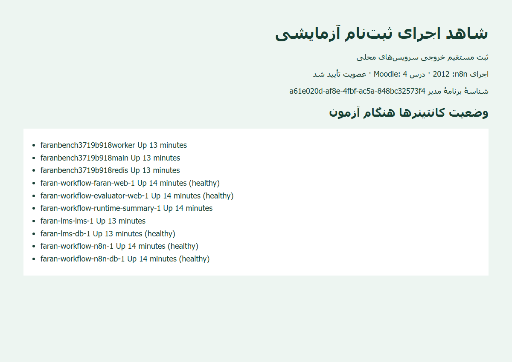
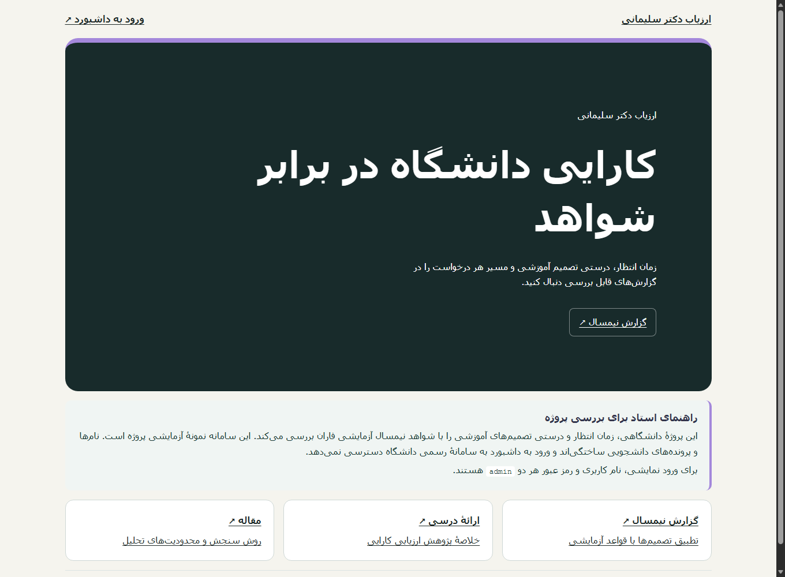
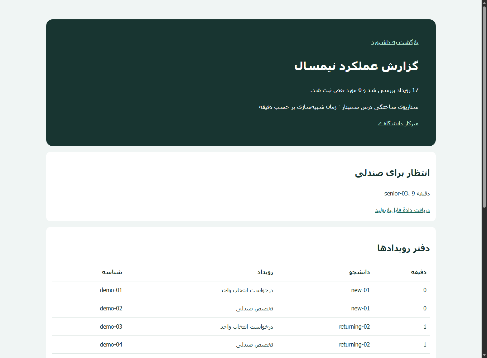

# چگونه عملکرد یک دانشگاه ایجنتیک را ارزیابی کنیم؟

**دانشجو:** محمد مهرانی

**نوع سند:** طرح روش و گزارش ارزیاب نمونه، نسخهٔ ۰٫۲
**درس:** ارزیابی کارایی سیستم‌های کامپیوتری
**استاد تحویل:** دکتر علی سلیمانی، مطابق صفحهٔ درس مشاهده‌شده در LMS فاران.

## چکیده

یک دانشگاه چندعاملی را نمی‌توان فقط با نرخ موفقیت آخرین وظیفه ارزیابی کرد. کیفیت ورودی، پایداری تکرار، زمان، هزینه، پیروی از سیاست و امکان بازتولید نتیجه نیز اهمیت دارند. این پروژه «دکتر سلیمانی» را به‌عنوان ارزیاب مستقل طراحی می‌کند: سامانه‌ای که رویدادهای پالایش‌شده را می‌خواند، عملکرد هر ایجنت و کل مسیر را تحلیل می‌کند، خطاهای قابل بررسی را نشان می‌دهد و برای اصلاح مسیر پیشنهاد می‌سازد. نسخهٔ حاضر آفلاین و ساختگی است؛ تحلیل آن نتیجهٔ آزمایش یک دانشگاه واقعی یا پیش‌بینی معتبر آینده نیست.

## مبنا

NIST AI RMF فعالیت‌های مدیریت ریسک را در کارکردهای Govern، Map، Measure و Manage سامان می‌دهد. این پروژه از آن‌ها فقط به‌عنوان راهنمای مفهومی برای پیوند حکمرانی، دامنه، اندازه‌گیری و اقدام استفاده می‌کند و ادعای انطباق رسمی ندارد. پژوهش‌های جدید ارزیابی عامل نیز بر سنجش هزینه، پایداری و منابع در کنار صحت و ارزیابی پیکربندی عامل تأکید می‌کنند. مقالهٔ arXiv دربارهٔ سنجش عامل به‌مثابه سامانه، پیش‌چاپ ۲۰۲۶ است؛ یافته‌های آن به‌تنهایی در نمونهٔ فاران تأیید نشده‌اند.

## روش و قرارداد

دانشگاه یک فایل JSON با `event_id`, `schema_version`, زمان وقوع، `agent_id`, `task_id`, وضعیت، هزینه، زمان اجرا، نسخهٔ سیاست و ارجاع شاهد می‌سازد. در نمونه، فایل فقط رویدادهای مصنوعی دارد و دادهٔ دانشجو/پیام یا محتوای خصوصی از LMS وارد نمی‌شود. ارزیاب شناسهٔ رویداد تکراری، وضعیت ناشناخته، نسخهٔ سیاست گمشده و `task_id` تکراری را گزارش می‌کند. وضعیت ناشناخته در مخرج نرخ موفقیت وارد نمی‌شود.

به‌ازای هر عامل، نرخ تکمیل، شکست، تکرار، زمان میانگین و هزینه محاسبه می‌شود. روند فقط با دست‌کم پنج بازهٔ روزانه نمایش داده می‌شود و برآورد خطی با دامنهٔ نوسان دادهٔ مشاهده‌شده همراه است. این فاصله، بازهٔ اطمینان آماری نیست. با دادهٔ کم نتیجه «ناکافی» می‌ماند.

## شواهد فعلی

یک fixture ساختگی هشت‌روزه در پنج نقش تولید می‌شود تا مسیر تحلیل موفق، شکست و تکرار قابل مشاهده باشد. نمونه برای آشنایی با رابط است و دادهٔ پژوهشی مستقل به شمار نمی‌آید. تعداد fixtureهای موفق در رابط به‌تنهایی شاهد عملکرد واقعی ایجنت‌های فاران نیست. فایل رویداد فاران نیز قابل بارگذاری است و گزارش JSON از همان مرورگر دانلود می‌شود.

ارزیاب برای هر نشانه پیشنهاد بازبینی وظیفه، ورودی، rubric، نسخهٔ policy یا idempotency ارائه می‌کند. تغییر دسترسی، آموزش، استخدام، نمره یا اختیار ایجنت به‌طور خودکار انجام نمی‌شود. تصمیم‌های حساس نیاز به مسئول انسانی و منبع معتبر دارند.

## محدودیت‌ها

نسخهٔ آغازین امضا یا اصالت فایل را بررسی نمی‌کند؛ حساب کاربری و پایگاه دادهٔ امن ندارد؛ به Paperclip یا LMS متصل نیست؛ هزینهٔ واقعی مدل را ثبت نمی‌کند؛ و پیش‌بینی آن baseline توصیفی است. دادهٔ پراکنده یا مفقود می‌تواند نرخ‌ها را گمراه کند. برای نتیجهٔ معتبر باید rubric دکتر سلیمانی، دادهٔ مجاز، نمونهٔ بزرگ‌تر، benchmark ثابت و بازبینی مستقل فراهم شود.

## نتیجه

دکتر سلیمانی در این مرحله یک داشبورد مرورگرمحور است که به کمک رویدادهای قابل ردیابی کارکرد ارزیابی مستقل را شفاف می‌کند. سهم این نمونه، اتصال گام‌به‌گام عملکرد ایجنت به شواهد و پیشنهاد اصلاحی است؛ سامانه هنوز نه عامل‌های دانشگاه را متوقف می‌کند و نه پیش‌بینی خود را مبنای تصمیم قرار می‌دهد. ارزیابی واقعی پس از تعیین rubric و دسترسی داده انجام خواهد شد.

## منابع

1. Tabassi, E. (2023). *Artificial Intelligence Risk Management Framework (AI RMF 1.0)*. NIST AI 100-1. https://doi.org/10.6028/NIST.AI.100-1
2. Wiedmann, L., Girrbach, L., Schmid, C., & Akata, Z. (2026). *Agents Are Systems, Not Models: Rethinking Agentic Evaluation*. arXiv:2610.01618, v1, پیش‌چاپ. https://arxiv.org/abs/2610.01618
3. Madiraju, M. B., & Madiraju, M. S. P. (2026). *AgentSLABench: Evaluating and Benchmarking Agentic Systems Under Resource Constraints*. arXiv:2608.00805, v1, پیش‌چاپ. https://arxiv.org/abs/2608.00805

---

**یادداشت ویراستاری:** متن با Persian Writing و Humanizer بازبینی شده است. مرز میان طراحی، fixture آزمایشی و نتیجهٔ تجربی مشخص است؛ مقاله ادعای داوری همتا یا پیش‌بینی عملیاتی نمی‌کند.

## مطالعهٔ موردی دپارتمان‌های فاران

در ۲۳ نوامبر ۲۰۲۶ ابتدا تاریخچهٔ خالی دانشگاه ثبت شد. سپس برای چهار نقش، چهار مأموریت محلی تعریف شد. مدیریت دانشگاه طرح پروژه را خواند، آموزش فهرست درس نمونه را بررسی کرد، مهندسی کامپیوتر مقالهٔ سمینار را خواند و فناوری اطلاعات پیکربندی سرویس‌ها را بررسی کرد. هر برنامه پس از خواندن فایل، تعداد خطوط غیرخالی را گزارش داد. خطای خواندن یا خالی بودن فایل باعث شکست برنامه می‌شد.

| نقش | موضوع بررسی | نتیجهٔ ثبت‌شده |
|---|---|---|
| مدیریت دانشگاه | طرح پروژه | موفق |
| مدیریت آموزش | درس سمینار | موفق |
| مهندسی کامپیوتر | مقالهٔ سمینار | موفق |
| فناوری اطلاعات | پیکربندی محلی | موفق |

واحد مشاهده یک اجرای پایان‌یافته در Paperclip است. در چهار اجرای بررسی‌شده، نسبت موفقیت فرایند ۴ از ۴ بود. آزمون برای هر نقش فقط یک بار انجام شد و موضوع چهار مأموریت متفاوت بود. رتبه‌بندی عامل‌ها یا پیش‌بینی روند با این نمونه توجیه تجربی ندارد. در ارزیاب، گزارشی که شرط شناسهٔ مأموریت را اعمال می‌کند می‌تواند تعداد کمتری رویداد قابل تحلیل نشان دهد.

این بررسی با دادهٔ آزمایشی و برنامهٔ قطعی انجام شد. برای سنجش کیفیت آموزشی باید خروجی هر مأموریت با معیار از پیش تعیین‌شده و داوری مستقل مقایسه شود.

## بازتولید آزمون از راه‌اندازی Docker

برای درس ارزیابی کارایی، این اجرا نمونه‌ای از تطبیق شواهد سه سرویس است. برای برآورد زمان انتظار باید زمان‌های شروع و پایان هر مرحله جدا ثبت شوند. این تصویر وضعیت عملیاتی را ثبت می‌کند و یک مشاهده برای برآورد توزیع تأخیر کافی نیست.

Docker Desktop را راه‌اندازی کنید و با docker ps بالا بودن پایگاه داده، Moodle، Redis و worker را بررسی کنید. پس از آماده شدن n8n، گردش‌کار محلی ثبت‌نام را فراخوانی کنید. شناسهٔ اجرای n8n و شناسهٔ برنامهٔ مدیر را بردارید. سپس عضویت آزمایشی را از Moodle بازخوانی کنید. در اجرای ثبت‌شده، n8n شمارهٔ ۲۰۱۲ و Moodle درس شمارهٔ ۴ را گزارش کردند. مرحلهٔ بازخوانی با ابزار محلی انجام شد.

[شواهد JSON](execution-evidence.json)

## ضمیمهٔ فنی زبان‌ها و الگوریتم‌ها

### HTML و CSS

HTML ساختار معنایی صفحه، فرم، جدول و مقاله را تعریف می‌کند. CSS جهت راست‌به‌چپ، چیدمان واکنش‌گرا، رنگ و وضعیت تمرکز را تنظیم می‌کند. این دو بخش رابط‌اند.

### JavaScript و Node.js

JavaScript منو، رویدادهای فرم و کنترل‌های داشبورد را اجرا می‌کند. فایل‌های .mjs ماژول‌های JavaScript هستند. فایل sw.js کش رابط مرورگر را مدیریت می‌کند. نشست نمایشی با sessionStorage نگه‌داری می‌شود.

### Java، Gradle و Capacitor

MainActivity.java نقطهٔ ورود بستهٔ اندروید است. Gradle فرایند ساخت را تنظیم می‌کند و Capacitor دارایی‌های وب را در پوستهٔ اندروید نمایش می‌دهد. منطق آموزشی یا آماری به Java منتقل نشده است.

### قالب‌ها و ابزار اجرا

JSON قالب تبادل رویداد و تعریف گردش‌کار است. YAML تنظیمات Compose یا GitHub Actions را نگه می‌دارد. SQL برای پرس‌وجو و نگه‌داری داده به‌کار می‌رود. تصویر به‌تنهایی جایگزین سند JSON نیست.

### Python و ورودی پژوهش

Python در review_cloud.py برای آماده‌سازی و پردازش دادهٔ آزمایشی به‌کار می‌رود. هستهٔ محاسبات وب در core.mjs اجرا می‌شود و ورودی آن آرایهٔ رخدادهای نسخه‌دار است.

### اعتبارسنجی و شاخص‌ها

core.mjs وجود شناسهٔ رویداد، زمان، عامل، تسک و وضعیت را بررسی می‌کند. نرخ تکمیل برابر تعداد رخدادهای completed تقسیم بر تعداد وضعیت‌های شناخته‌شده است. تکرار شناسهٔ رویداد جدا از تکرار شناسهٔ تسک گزارش می‌شود. مرتب‌سازی زمانی O(N log N) و گروه‌بندی با Map و Set به‌طور متوسط O(N) است. حافظه O(N) است.

### میانه، صدک و تفکیک تأخیر

measure.mjs زمان‌های معتبر را مرتب می‌کند و صدک را با رتبهٔ ⌈pN⌉ به دست می‌آورد. زمان‌سنج trace.mjs بازه‌های انتظار، خدمت و تحویل را با ترتیب زمانی کنترل می‌کند. زمان پیش از اولین گره در CLI شامل آماده‌سازی هم هست. سهم صف Redis جداگانه از ساعت همان Redis اندازه‌گیری شد.

### برآورد روند با پنج روز

پنج نرخ روزانهٔ آخر به ترتیب زمانی انتخاب می‌شوند. شیب بر حسب ترتیب نمونه با کمترین مربعات محاسبه و به آخرین نرخ افزوده می‌شود. برآورد به بازهٔ صفر تا یک محدود است. دامنهٔ گزارش از پراکندگی پنج نرخ به دست می‌آید و تفسیر فاصلهٔ اطمینان ندارد. در کمتر از پنج روز، برآورد ارائه نمی‌شود.

### انطباق با قواعد آموزشی

در سناریوی نیمسال، وضعیت عضویت، صف و تاریخچهٔ هر پرونده با رویدادها به‌روز می‌شود. ظرفیت، تقدم صف و منع فراغت هنگام اعتراض باز کنترل می‌شوند. هر یافته باید به شناسهٔ رویداد و قاعده مربوط باشد. نتیجه به دامنهٔ سناریو و کامل‌بودن شواهد وابسته است.

